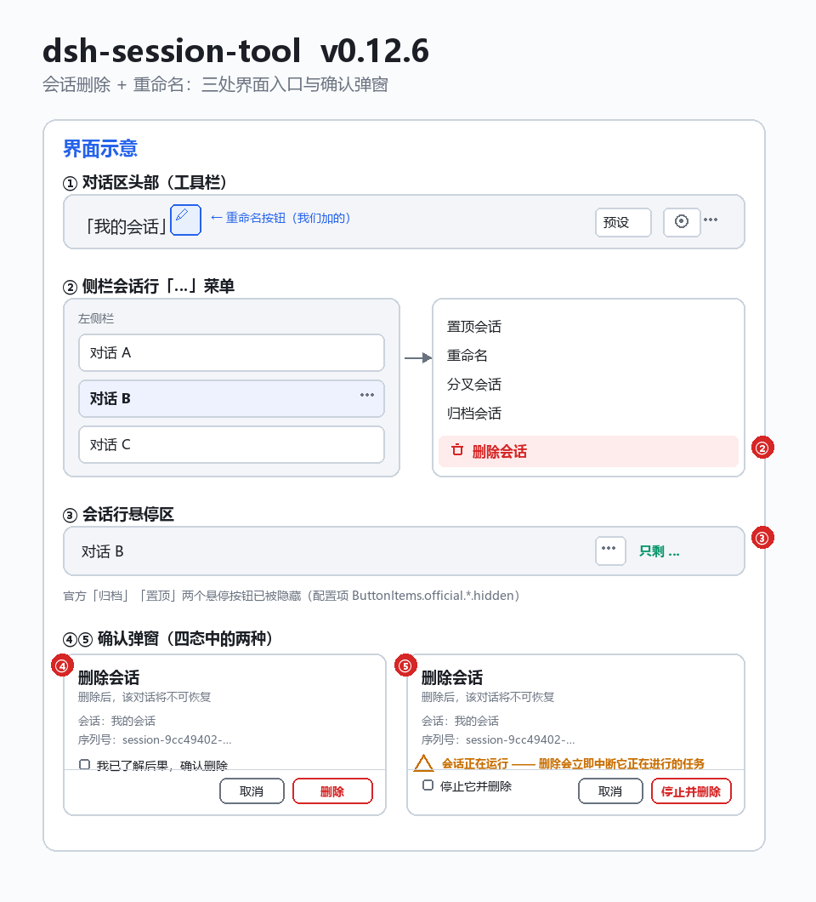

# dsh-session-tool

会话太多删不掉？归档只是隐藏、记录还躺在磁盘上？想给一个会话换个名字还要翻菜单？

**给 DSH 补上会话管理：侧栏「⋯」菜单一键删除（永久删除、可配置），对话区头部一键重命名。**

> ⚠️ **删除是永久删除，不可恢复**（本插件没有回收站）。删除**正在运行**的会话时，会**先停止该会话，然后再删除**。



## 安装

```sh
# npm
dsh plugin --profile <profile> add dsh-session-tool

# 本地目录
dsh plugin --profile <profile> add file:C:/path/to/dsh-session-tool

# GitHub
dsh plugin --profile <profile> add github:<owner>/dsh-session-tool
```

装完**重启 DSH**。`<profile>` 替换成你的 profile 名（如 `web`、`desktop`）。

## 功能

- **⋯ 菜单「删除会话」**：文案、顺序、显隐、红色危险样式、禁用态都可配置
- **头部「重命名会话」✏️**：走官方 `sessions` 服务，改完侧栏与头部标题即时更新
- **一次确认**：勾选「我已了解后果」才能点删除（未勾选时按钮禁用）
- **永久删除 + 先停止**：运行中的会话先 `cancel` 并等静默（最多 15 秒），再 flush/detach，最后删除目录并清理记账
- **官方悬停按钮可隐藏**：归档 / 置顶两个图标按钮（只支持 `hidden`）
- **审计日志**：配置问题与每一次删除都写 `~/.dsh/logs/dsh-session-tool.log`

## 配置

写在 profile 的 `cordis.patch.yml`（`~/.dsh/profiles/<profile>/cordis.patch.yml`），**键名区分大小写**，改完**重启 DSH** 生效。
**只写你要改的部分**，没写的键全部用默认值。

### 完整 schema

```yaml
- id: dsh-session-tool
  name: dsh-session-tool
  config:
    MenuItems:                     # ⋯ 菜单里的项
      official:                    # 官方 4 项（不写 = 一个都不碰）
        pin:     { }               # 可写：label / activeLabel / order / hidden
        rename:  { }               # 只支持 hidden（重命名对话框是官方内部实现）
        fork:    { }               # 可写：label / order / hidden
        archive: { }               # 可写：label / activeLabel / order / hidden
      plugin:
        delete:
          label: "删除会话"         # 文案（留空 = 跟随系统语言）
          order: 500               # 顺序，越小越靠前
          hidden: false            # true = 隐藏这一项
          danger: true             # 红色危险样式
          disabled: false          # 禁用态：变灰、点不动
          shortcut: null           # 【已登记，本阶段未实现】
          separatorBefore: false   # 【已登记，本阶段未实现】
    ButtonItems:                   # 会话行悬停时的图标按钮
      official:
        archive: { hidden: false } # 只支持 hidden
        pin:     { hidden: false } # 只支持 hidden（已归档的行上本来也不显示）
      plugin: { }                  # 占位：本插件不提供悬停按钮
```

### order 参考值

`order` 是普通数字，**升序排列**：越小越靠前；**不写等于 0**（会排在最前面）；数字相同则按注册顺序（官方先注册，排在我们前面）。

| order | 菜单项 | 来源 | 能否修改 |
| --- | --- | --- | --- |
| 100 | 置顶会话 `pin` | 官方 | label / activeLabel / order / hidden |
| 200 | 重命名 `rename` | 官方 | ⚠️ 只能 hidden |
| 300 | 分叉会话 `fork` | 官方 | label / order / hidden |
| 400 | 归档会话 `archive` | 官方 | label / activeLabel / order / hidden |
| 500 | 删除会话 `delete` | 本插件（默认） | 全部字段 |

| order | 悬停按钮 | 来源 | 能否修改 |
| --- | --- | --- | --- |
| 100 | 归档按钮 | 官方 | ⚠️ 只能 hidden |
| 200 | 置顶按钮 | 官方 | ⚠️ 只能 hidden |

### 我的配置（实际在用的）

```yaml
# order 参考：官方 pin 100 / rename 200 / fork 300 / archive 400；本插件 delete 默认 500
- id: dsh-session-tool
  name: dsh-session-tool
  config:
    MenuItems:                     # ⋯ 菜单里的项
      official:                    # 官方 4 项：不写就不碰
        pin: {}                    # 可写：label / activeLabel / order / hidden
        rename: {}                 # 只支持 hidden
        fork: {}                   # 可写：label / order / hidden
        archive: {}                # 可写：label / activeLabel / order / hidden
      plugin:
        delete:                    # 本插件唯一的菜单项
          label: "删除会话"
          order: 500
          hidden: false
          danger: true             # 红色危险样式
          disabled: false          # 禁用态（变灰、点不动）
    ButtonItems:                   # 会话行【悬停时】的图标按钮
      official:
        archive:
          hidden: true             # 隐藏官方悬停「归档」按钮
        pin:
          hidden: true             # 隐藏官方悬停「置顶」按钮
      plugin: {}                   # 占位：本插件不提供悬停按钮
```

## 界面

| 位置 | 内容 |
| --- | --- |
| 侧栏会话行「⋯」菜单 | 「删除会话」（文案/顺序/显隐/危险样式/禁用态可配） |
| 对话区头部工具栏 | ✏️「重命名会话」（该排最左侧） |
| 会话行悬停区 | 官方归档/置顶按钮（可隐藏）；本插件不提供悬停按钮 |

**删除弹窗四态**

| 状态 | 触发 | 表现 |
| --- | --- | --- |
| 正常 | 会话在列表且未运行 | 副标题「删除后，该对话将不可恢复」+ 勾选框 + 删除按钮（未勾选时禁用） |
| 运行中 | 会话正在运行 | 多一行 ⚠「会话正在运行 —— 删除会立即中断它正在进行的任务」，勾选框与按钮变成「停止并删除」 |
| 会话不存在 | 列表里找不到该会话 | 提示刷新后重试，隐藏勾选框、禁用删除按钮 |
| 删除成功 | 删除完成 | 「已删除」+「该对话已永久删除，无法恢复。」+ 完成按钮 |

**重命名**：输入框预填当前名称、自动聚焦；名称为空时「确定」禁用；回车提交、Esc 取消；失败在弹窗内显示原因。

## 实现说明

**删除链路**（六步）

1. 界面校验：回环地址 + 同源请求（其他来源 403，方法不对 405）
2. 运行中的会话：`cancel` 取消回合并等待静默（最多 15 秒）
3. `flush` 写盘 + 从内存会话表 `detach`，避免收尾阶段把日志目录重建回来
4. **删除磁盘目录**（收尾再扫一遍）—— 这一步是永久删除，文件不进入任何回收目录
5. 清理记账：投影缓存行、投影缓存文件、工作区 `sessionIds`、归档集合
6. 写审计日志

**加载稳健性**

- 客户端 `apply` **必须同步完成**：任何 `await`（尤其是网络请求）都可能让入口永远停在 `loading`
- 界面配置在后台读取（3 秒超时、失败重试 5 次 × 2 秒），到达后自动重建注册；读不到就用默认值
- 宿主的三条 HTTP 路由按**进程级单例**注册（同进程重复加载时复用，不撞 `duplicate exact route`）

**官方悬停按钮的隐藏是怎么实现的（维护提示）**

插槽契约写着「复用官方 id 就会替换那一行」，但实测**跨插件不可靠**：框架给每个插件各自分配注册优先级，
官方注册的条目数量多、计数更靠前，于是官方那行仍然胜出。所以本插件改用 **DOM/CSS 级隐藏**：

```html
<style id="dsh-session-tool-hide-shipped">
  button[aria-label="归档会话"],button[aria-label="取消归档"],
  button[aria-label="Archive session"],button[aria-label="Unarchive session"],
  button[aria-label="置顶会话"],button[aria-label="取消置顶"],
  button[aria-label="Pin session"],button[aria-label="Unpin session"] { display: none !important; }
</style>
```

> ⚠️ **维护提示**：这段选择器依赖官方按钮的 `aria-label` 文案（中英各 2 种状态，共 8 条）。
> 如果 DSH 更新后官方改了这些文案（或新增状态），隐藏会失效 —— 此时只需在 `lib/client.js` 的
> `ARCHIVE_LABELS` / `PIN_LABELS` 两个数组里补上新文案即可。日志里每次加载都会记录 `cssRules=<条数>`，可用来核对。

## 日志

`~/.dsh/logs/dsh-session-tool.log`（超过 1 MB 轮转为 `.log.1`）

```
[2026-10-16T09:08:44.519Z] delete ok     id=session-9cc49402-…  title="创建三个空子智能（9cc49402）"  running=false  stopped=false  dirs=1  elapsed=0.0s
[...] plugin info   HTTP 路由已注册：/list /config /diag /delete
[...] config warn   未知的配置键 "menuItems" → 你是否想写 "MenuItems"？（键名区分大小写）
[...] client info   config #1: ok | changed=true | hiddenButtons=archive,pin | cssRules=8
```

配置写错**不会**打断 DSH 启动，只会记一行日志并忽略该项。

## 卸载

```sh
dsh plugin --profile <profile> remove dsh-session-tool
```

## 更新日志

完整版本记录见 [`changelog/CHANGELOG.md`](changelog/CHANGELOG.md)。

## 许可

MIT

---

# dsh-session-tool

Too many sessions and no way to remove them? Archiving only hides a session while its files stay on disk? Renaming a session means digging through menus?

**Session management for DSH: delete from the sidebar "..." menu (permanent, configurable) and rename from the conversation header.**

> ⚠️ **Deletion is permanent and unrecoverable** (there is no trash). Deleting a **running** session first stops it, then removes it.


## Installation

```sh
# npm
dsh plugin --profile <profile> add dsh-session-tool

# local checkout
dsh plugin --profile <profile> add file:C:/path/to/dsh-session-tool

# GitHub
dsh plugin --profile <profile> add github:<owner>/dsh-session-tool
```

Restart DSH afterwards. Replace `<profile>` with your profile name (e.g. `web`, `desktop`).

## Features

- **"..." menu item "Delete session"**: label, order, visibility, danger styling and disabled state are all configurable
- **Header "Rename session"** (pencil): uses the official `sessions` service, so the sidebar and header titles update live
- **Single confirmation**: the delete button stays disabled until "I understand the consequences" is ticked
- **Permanent delete, stop-first**: a running session is cancelled and awaited (up to 15 s), flushed and detached, then its directories are removed and the accounting is cleaned
- **Official hover buttons can be hidden**: the archive and pin icons (only `hidden` is supported)
- **Audit log**: configuration problems and every deletion are written to `~/.dsh/logs/dsh-session-tool.log`

## Configuration

Put it in the profile patch file `~/.dsh/profiles/<profile>/cordis.patch.yml`. **Keys are case-sensitive** and changes apply after **restarting DSH**.
**Only write what you want to change** - everything omitted keeps its default.

### Full schema

```yaml
- id: dsh-session-tool
  name: dsh-session-tool
  config:
    MenuItems:                     # items in the "..." menu
      official:                    # the 4 shipped items (omitting one leaves it untouched)
        pin:     { }               # writable: label / activeLabel / order / hidden
        rename:  { }               # hidden only (its dialog is official internals)
        fork:    { }               # writable: label / order / hidden
        archive: { }               # writable: label / activeLabel / order / hidden
      plugin:
        delete:
          label: "Delete session"   # empty string = follow the system language
          order: 500               # ascending; smaller values come first
          hidden: false            # true = hide this item
          danger: true             # red danger styling
          disabled: false          # disabled state: greyed out, not clickable
          shortcut: null           # [registered, not implemented yet]
          separatorBefore: false   # [registered, not implemented yet]
    ButtonItems:                   # hover icons on a session row
      official:
        archive: { hidden: false } # hidden only
        pin:     { hidden: false } # hidden only (never shown on archived rows anyway)
      plugin: { }                  # placeholder: this plugin adds no hover buttons
```

### order reference

`order` is a plain number, sorted **ascending**: smaller comes first; **omitted means 0** (which puts it first); equal values keep registration order (shipped items register first, so they come before ours).

| order | Menu item | Owner | Editable |
| --- | --- | --- | --- |
| 100 | Pin session `pin` | shipped | label / activeLabel / order / hidden |
| 200 | Rename `rename` | shipped | ⚠️ hidden only |
| 300 | Fork session `fork` | shipped | label / order / hidden |
| 400 | Archive session `archive` | shipped | label / activeLabel / order / hidden |
| 500 | Delete session `delete` | this plugin (default) | every field |

| order | Hover button | Owner | Editable |
| --- | --- | --- | --- |
| 100 | Archive | shipped | ⚠️ hidden only |
| 200 | Pin | shipped | ⚠️ hidden only |

### My configuration (what I actually run)

```yaml
# order reference: shipped pin 100 / rename 200 / fork 300 / archive 400; this plugin's delete defaults to 500
- id: dsh-session-tool
  name: dsh-session-tool
  config:
    MenuItems:                     # items in the "..." menu
      official:                    # the 4 shipped items: omit = never touch
        pin: {}                    # writable: label / activeLabel / order / hidden
        rename: {}                 # hidden only
        fork: {}                   # writable: label / order / hidden
        archive: {}                # writable: label / activeLabel / order / hidden
      plugin:
        delete:                    # the only menu item this plugin adds
          label: "Delete session"
          order: 500
          hidden: false
          danger: true             # red danger styling
          disabled: false          # disabled state (greyed out, not clickable)
    ButtonItems:                   # hover icons on a session row
      official:
        archive:
          hidden: true             # hide the shipped archive hover button
        pin:
          hidden: true             # hide the shipped pin hover button
      plugin: {}                   # placeholder: this plugin adds no hover buttons
```

## UI

| Where | What |
| --- | --- |
| Sidebar session row "..." menu | "Delete session" (label/order/visibility/danger/disabled configurable) |
| Conversation header toolbar | Pencil "Rename session" (leftmost in that row) |
| Session row hover area | shipped archive/pin buttons (can be hidden); this plugin adds none |

**Delete dialog, four states**

| State | Trigger | Behaviour |
| --- | --- | --- |
| Normal | session exists and is idle | subtitle "This conversation will be permanently deleted" + checkbox + delete button (disabled until ticked) |
| Running | session is running | an extra ⚠ line "The session is running - deleting interrupts its work immediately"; checkbox and button become "Stop and delete" |
| Missing | the session is gone | asks you to refresh, hides the checkbox and disables the delete button |
| Done | deletion finished | "Deleted" + "The conversation has been permanently deleted." + a finish button |

**Rename**: the input is prefilled with the current title and focused; confirm is disabled while empty; Enter submits, Esc cancels; failures are shown inside the dialog.

## Implementation notes

**Delete pipeline** (six steps)

1. UI guard: loopback address plus same-origin request (403 otherwise, 405 for wrong methods)
2. Running sessions: `cancel` the turn and wait for silence (up to 15 s)
3. `flush` to disk and `detach` from the in-memory session table so dispose-time writes cannot recreate the log directory
4. **Remove the directories** (with a final sweep) - this step is permanent, nothing goes to a trash folder
5. Clean the accounting: projection rows, projection cache file, workspace `sessionIds`, archived set
6. Write the audit log line

**Load robustness**

- The client `apply` **must finish synchronously**: any `await` (especially a network request) can leave the entry stuck in `loading` forever
- The UI configuration is fetched in the background (3 s timeout, 5 retries x 2 s) and registrations are rebuilt when it arrives; if it never arrives the defaults are used
- The three host HTTP routes are registered as a **process-wide singleton** (reused when the plugin loads twice in one process, avoiding `duplicate exact route`)

**How the shipped hover buttons are hidden (maintenance note)**

The slot contract says reusing a shipped id replaces that row, but in practice this is **unreliable across plugins**: the framework assigns
registration priorities **per plugin**, and the shipped plugin registers many entries so its counter is ahead - the shipped row still wins.
This plugin therefore uses **DOM/CSS hiding** instead:

```html
<style id="dsh-session-tool-hide-shipped">
  button[aria-label="归档会话"],button[aria-label="取消归档"],
  button[aria-label="Archive session"],button[aria-label="Unarchive session"],
  button[aria-label="置顶会话"],button[aria-label="取消置顶"],
  button[aria-label="Pin session"],button[aria-label="Unpin session"] { display: none !important; }
</style>
```

> ⚠️ **Maintenance note**: these selectors depend on the shipped `aria-label` strings (2 states in each of zh/en, 8 rules in total).
> If a DSH update changes those strings (or adds a state), hiding stops working - just add the new strings to `ARCHIVE_LABELS` /
> `PIN_LABELS` in `lib/client.js`. Every load logs `cssRules=<count>` so you can verify what was injected.

## Log

`~/.dsh/logs/dsh-session-tool.log` (rotated to `.log.1` above 1 MB)

```
[2026-10-16T09:08:44.519Z] delete ok     id=session-9cc49402-...  title="Create three empty subagents (9cc49402)"  running=false  stopped=false  dirs=1  elapsed=0.0s
[...] plugin info   HTTP routes registered: /list /config /diag /delete
[...] config warn   unknown config key "menuItems" -> did you mean "MenuItems"? (keys are case-sensitive)
[...] client info   config #1: ok | changed=true | hiddenButtons=archive,pin | cssRules=8
```

A bad configuration **never** blocks DSH startup: it only logs one line and ignores that entry.

## Uninstall

```sh
dsh plugin --profile <profile> remove dsh-session-tool
```

## Changelog

See [`changelog/CHANGELOG.md`](changelog/CHANGELOG.md) (Chinese).

## License

MIT
